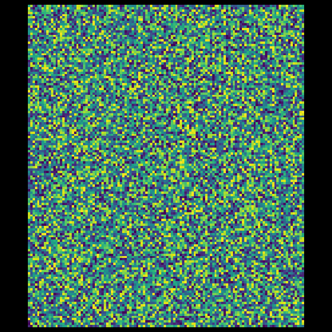

# Sorting Algorithm Visualizer

A command-line Python program that visualizes sorting algorithms as either an
animated GIF or a static image. The visualizations show values as colors and
make the algorithms' movement through a sequence visible.



## Requirements

Python 3 and the NumPy and Matplotlib packages are required. Install the
dependencies with:

```bash
python3 -m pip install numpy matplotlib
```

## Usage

Run the script from the project directory. With no options, it creates a
bubble-sort animated GIF using the `viridis` colormap:

```bash
python3 sorting_algo_visualizer.py
```

Choose an algorithm, output type, initial order (for static images), and
Matplotlib colormap with these options:

```bash
python3 sorting_algo_visualizer.py -sorter heap -out video -c viridis
python3 sorting_algo_visualizer.py -sorter quick -out image -order reverse -c magma
```

| Option | Default | Description |
| --- | --- | --- |
| `-sorter` | `bubble` | Algorithm to visualize (see the list below). |
| `-out` | `video` | Output type: `video` for an animated GIF or `image` for a static PNG. |
| `-order` | `random` | Starting order for image output: `random`, `reverse`, `interleave`, `swappedhalf`, or `interleavehalf`. |
| `-c` | `viridis` | Matplotlib colormap name. |

Available sorter names are `bubble`, `quick`, `dualpivotquick`, `heap`,
`insertion`, `tim`, `selection`, `cocktail`, `shell`, `stooge`, `comb`,
`oddeven`, `merge`, and `bitonic`.

The `-order` option applies to image output; video output generates its own
randomized rows. Files are written under `output/video/` as GIFs or
`output/image/` as PNGs. The output directories are created automatically.

